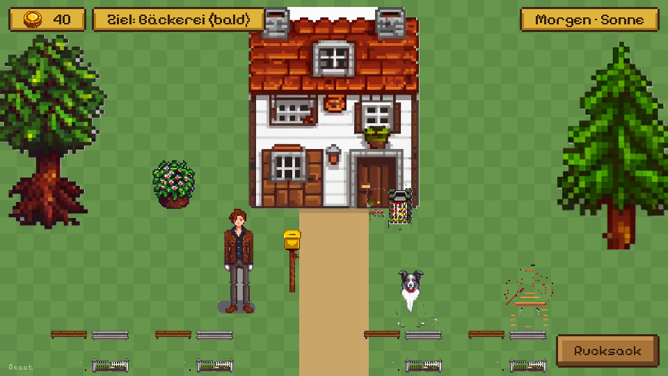

# DeutschSpiel: Stillbach

Немецкий A1 → C1 как игра. Говоришь по-немецки, и деревня Stillbach оживает.

**Играть:** https://kamaelises.github.io/deutschspiel-stillbach/ (браузер, телефон или ПК; микрофон по желанию)



## Что внутри
| Папка | Что |
|---|---|
| `docs/` | Игра (Phaser 4, без сборки), её же отдаёт GitHub Pages |
| `design-doc/` | Концепт, геймдизайн, арт, архитектура, роадмап |
| `AGENTS.md` | Правила для ИИ-агентов (Claude Code, Codex) |
| `skills/` | Скиллы агентов: урок-сцена, проверка кадрами, приём ассетов |
| `tools/` | `shot_proto.cjs`: снимает 6 кадров потока |

## Запуск локально
```
npx serve docs          # или любой статический сервер
node tools/shot_proto.cjs   # кадры в docs/shots/ (нужен playwright)
```

## Основа
Структура и правила агентов взяты из [ai-gamedev-starter-kit](https://github.com/Saneety/ai-gamedev-starter-kit), автор Антон Рубан, лицензия CC BY-NC-SA 4.0.

## Лицензия
CC BY-NC-SA 4.0 (некоммерческое использование). Phaser: MIT. Шрифты Pixelify Sans, Press Start 2P, VT323: SIL OFL 1.1. Голос: Piper (Thorsten). Текст учебника в репозиторий не входит.
